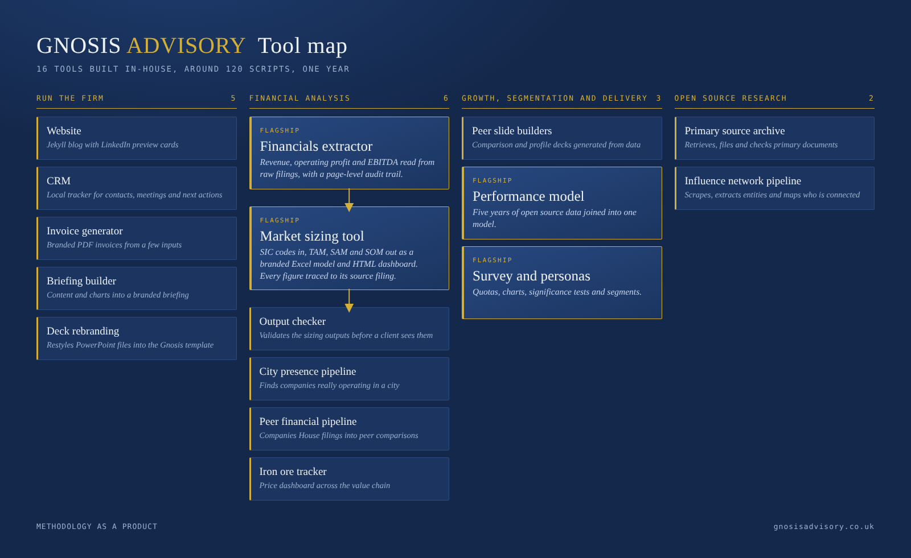
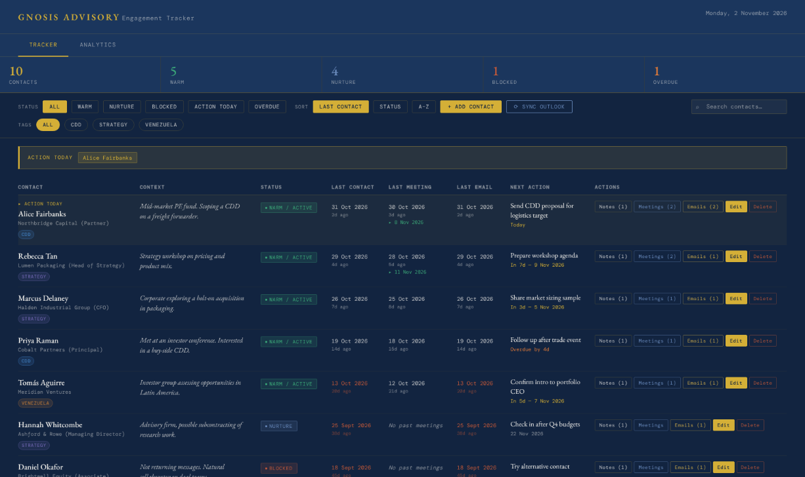
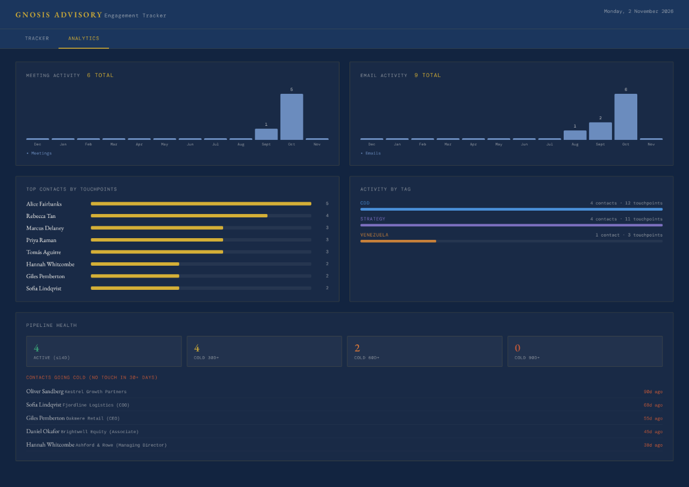

## In the old consulting world, methodology got you projects

I was working for a boutique strategy firm just after covid and we were trying to rebuild the customer pipeline. We miraculously got in touch with a new, growing PE fund based in Austria that needed help with the CDD process for a specific niche acquisition. Before they would move forward, however, they wanted to get a better feel for our methodology. Of course we scrambled something together, landed that project and built an interesting relationship on the back of it. That resonated with a comment made by a very experienced consultant when I asked him how I could win new PE clients. He told me: “PE funds like to know that you have a CDD methodology. They will take you more seriously if you do.” That made sense in a world where BCG came up with the “BCG matrix”[^1], GE and McKinsey developed the “nine-box matrix”[^2], and Bain created the Net Promoter Score[^3]. In that universe, the signature delivery was the diagram that explained 80% of the world[^4].

## Then the deck stopped being proof

A German sociologist, Michael Hartmann, who studies how top managers are recruited, described how hiring firms sometimes put CEOs forward for roles partly because of the strength of their handshake. These small daily signals, what Bourdieu called “habitus”, told the board that the candidate knew the market, but also that he knew how to behave. They worked because everyday actions are signs of the larger social structure behind a person. A deck used to work in the same way. A deck has to look good, otherwise we do not trust the data, and a polished deck was hard to produce. It took a team and several weeks, so it signalled that a real process stood behind it.

That signal has now collapsed. Since the advent of LLMs, any firm, and any individual, has access to the same tools that we do, and a good-looking deck can be produced in an afternoon. **The deck can look right while the data underneath is wrong, and the reader cannot tell.** The same logic applies to large firms as much as to small ones: if a polished deck is no longer proof of a rigorous process, everyone will need something else to show. McKinsey’s [QuantumBlack Labs](https://ceros.mckinsey.com/qb-labs-mobile-1-1/p/1), for example, lists 25+ proprietary tools (as of November 2026), which suggests the large firms can see where credibility is moving.

> The deck can look right while the data underneath is wrong, and the reader cannot tell.

LLMs have distorted the “vibes” of what makes a good presentation. Some experienced consultants still cannot use them to produce deliverables that “feel” professional, and some outputs still feel “AI”. But more and more practitioners will be able to produce nice-looking work. The real differentiator will no longer be how it looks, but what is under the hood.

## What cannot be faked overnight

**What cannot be faked overnight is a set of connected tools that has been through many projects, because that takes time.** Take our market sizing tool. We started with the sizing itself, then realised the real problem was the financial data, so we worked on extraction. Then we automated the download of filings from Companies House, which meant that adding fifteen new companies to a test cost next to nothing. We could test more and more cases, and every case that broke the tool went into a testing tool as an edge case. We used the agent only to find where the tool failed, and fixed each failure in the code. Each tool fed the next: faster downloads gave us more test cases, more test cases gave us a better extractor, and a better extractor gave us a better market model. In its first version, on our rough count, around 60% of the figures came out right, mostly because the tool did not recognise the same company across different filings. Revenue now matches independent, machine-readable filings in 97% of the cases we could check. Lines further down the accounts, such as cash and depreciation, are less reliable, and the remaining gaps are corrected with Claude.

> What cannot be faked overnight is a set of connected tools that has been through many projects, because that takes time.

The download tool alone saves about three hours at the start of every project. Over five projects that is fifteen hours, and the fifth project starts from a better tool than the first.

## A tech stack aggregates knowledge

That is the difference from what people call an “agentic architecture”, or a swarm. A swarm gives very detailed instructions to a probabilistic LLM and hopes that, in the hundreds of times it is used, a one percent crazy outcome does not occur. Run the same swarm five times and you get the same thing five times. It only gets better when the model gets better, which means it only gets better if you pay the model provider more. You are renting the improvement. A tech stack works differently. Each project leaves the tool better than it found it, because what was learned is written into software: the edge cases, the fixes, the checks. Economists call this increasing returns: the more it is used, the more it is worth. And because the pieces are software and do not run on tokens, they can be tested systematically, for instance as part of a client’s procurement process. We built the tools with the help of an LLM, but once built they run without one and keep working when the models change.

The most telling sign of an incomplete solution is the swarm. It may calculate the data correctly, but only in the way a broken clock is right twice a day.

## A tech stack is an institution

A company is a type of institution: something that outlasts the people inside it. A freelancer’s knowledge leaves with them at the end of each project. **A tech stack holds what has been learned, so it is what turns a freelancer into a firm.** A swarm learns nothing that stays, so it does not create a company. That is my answer to a question I asked myself this year: why build a consultancy and not a freelance career?

> A tech stack holds what has been learned, so it is what turns a freelancer into a firm.

At Gnosis Advisory we have spent the better part of a year building a native tech stack of 16 tools. They range from back-office tools to data products and automated delivery, covering research from financial modelling to expert interview data and the systematic review of primary sources. The stack is scalable and works for small engagements and large projects.

*Image 1. Gnosis Advisory Tool Map*

The best way to know if someone has a tech stack based delivery is to ask whether they have automated their back office. It seems a bit nosy, but it is where the real differentiation happens. A company that uses agentic coding to make its own life easier and far less expensive knows how to use an LLM. A company whose only trick is running six agent sessions at the same time is a power user, not a company. It may even produce a nice-looking result in the background, but that workflow will break the moment the models change.

### Run the firm

The back office at Gnosis relies on five tools. The first manages the website and the SEO strategy (written in HTML and CSS in a GitHub repository). The second creates invoices in our own format. The third produces briefings and proposals in the right format, quickly. The fourth restyles PowerPoint decks into the Gnosis Advisory template. The fifth is a CRM that is updated daily, runs locally on our own machine and provides analytics on outreach and people of interest.

The reason to look at the back office first is that it answers the question of how we can deliver larger projects with very lean teams and still run a company. Five years ago the answer would have been little sleep, until I could afford to hire someone permanently. Now it is because we have streamlined operations.

*Image 2. Gnosis CRM tracker view (illustrative data).*

*Image 3. Gnosis CRM analytics view (illustrative data).*

### Financial analysis

The first group of tools automates the analysis of financial data. The main one is the [market sizing tool](https://gnosisadvisory.co.uk/insights/2026/replacing-pitchbook-market-sizing-tool/), which produces TAM, SAM and SOM. Since its creation we have refined it over a few projects and built a series of interconnected tools around it. One reads company accounts and extracts revenue, operating profit and EBITDA, another validates the figures, and together they download the data, size the market and check the numbers in a loop.

This suite can be adapted to different questions. It can be used to understand a market in a specific city, or how a group of peer companies performs. The structure is the same for all: automated download of real company reports, scanning of the reports and cross-checking. That architecture can then feed the delivery.

### Growth, segmentation and delivery

One of the most important updates of the past year has been automating the analysis of internal and customer data, so that analysis at scale still ends in a narrative deliverable with a controlled look.

At the centre of this is Python code that links the data held in a repository for each project to a fixed PowerPoint framework. This locks in the visual identity of the deliverable and allows much more detailed slides. In the past we would first write VBA code to analyse survey data, use the results to build tables and graphs in Excel, and then link those graphs to PowerPoint. Now a Python architecture produces the graphs from a CSV file, places them in the right spot on a slide and writes the missing elements that drive the narrative. This translates the logic of a [product-led consulting project](https://gnosisadvisory.co.uk/insights/2026/agentic-but-deterministic/) into a PowerPoint deliverable. It is the safest way we know of creating decks at scale with insight generation, something that was not available in the past.

### Open source research

We are also able to run open source research at scale using publicly available data. For instance, we built a database of over 1,000 sources on a specific topic, which can be repeated for an M&A context slide or a trends analysis using specific keywords. We also built a network analysis tool to understand groups of power in countries with limited data and limited access to sources.

## Three questions for choosing an adviser

Some firms are letting young power users build agentic frameworks. A framework nobody can inspect does not reassure the people who need to know the data is sound, and it cannot explain to an overworked analyst why a result came out the way it did.

Our solution has been to always document the code the agents use to create the output. In doing so we have built an interconnected tech stack for automated delivery that has proven scalable and is the backbone of how Gnosis Advisory delivers projects.

If you are choosing an adviser, three questions will tell you most of what you need to know.

1. Have you automated your own back office?
2. Can you show me the code behind a number in your deck?
3. What happens to your process when the model changes?

**The answers tell you whether you are hiring a firm or a power user.**

[^1]: The BCG matrix is a 2x2 portfolio tool, introduced by Boston Consulting Group in the early 1970s, that plots each business unit by market growth rate and relative market share to sort it into one of four categories: stars (high growth, high share), cash cows (low growth, high share), question marks (high growth, low share) and dogs (low growth, low share), with cash from the cash cows funding investment in the stars and question marks.

[^2]: A 3x3 grid for prioritising business units or investments. One axis is industry attractiveness (market size, growth, profitability), the other is competitive strength (share, brand, cost position), each rated high, medium or low. Units in the top-left (strong and attractive) get investment, those on the diagonal are selectively managed, and those in the bottom-right are harvested or divested. It refines the BCG matrix by using composite scores instead of just growth and share.

[^3]: A loyalty metric from one question: “How likely are you to recommend us to a friend or colleague?”, scored 0 to 10. Scores of 9-10 are promoters, 7-8 are passives (ignored in the calculation), and 0-6 are detractors. NPS is the percentage of promoters minus the percentage of detractors, so it ranges from -100 to +100. Fred Reichheld of Bain introduced it in 2003.

[^4]: The observation that roughly 80% of effects come from 20% of causes, such as 80% of revenue from 20% of customers or 80% of defects from 20% of issues. It comes from Vilfredo Pareto’s finding that about 80% of Italian land was owned by 20% of the population. The figures are a rule of thumb rather than a law, but the point is that outcomes are usually concentrated, so effort should go to the vital few.
